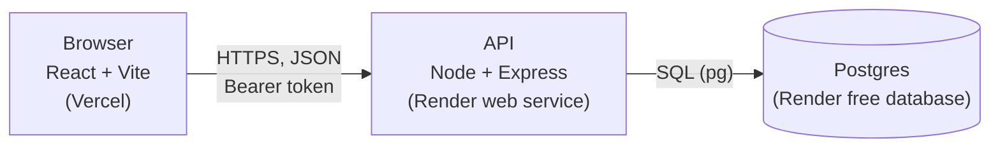
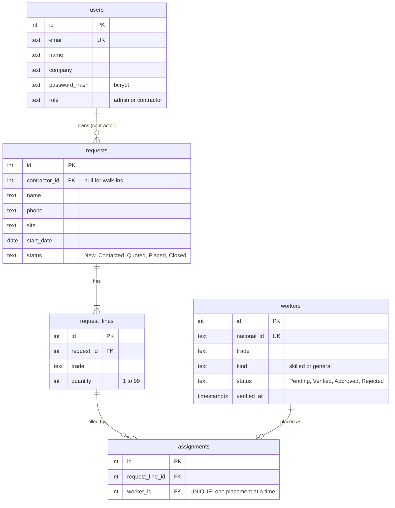

# Skill Sync

A construction staffing agency for Nairobi sites. Contractors request workers, workers apply, and an admin checks the workers and places approved ones on requests.

## Architecture

A normal three-tier system.



| Tier | Tech | Where | Job |
|---|---|---|---|
| Browser | React 18, Vite, React Router | Vercel | Forms and screens. Checks input for quick feedback |
| API | Node, Express 5 | Render (free web service) | Re-checks every rule, logs people in, enforces roles, runs placements |
| Database | Postgres | Render (free) | Stores everything. Constraints are a last line of defence |

Why Postgres and not MySQL: Render's free database is Postgres only.

## Database



## Rules the server enforces

The React forms check input, but the server repeats every check, so the rules hold even if someone calls the API directly (`server/src/validate.js`).

- **Request:** at least one known trade, each quantity a whole number 1 to 99; name; Kenyan mobile number; site; real start date that is not in the past; length from the list.
- **Worker application:** full name, Kenyan mobile, 7 or 8 digit national ID (one application per ID), age 18 to 35, known trade and county, consent.
- **Worker status:** `Pending → Verified → Approved`. Approving without verifying is refused. Verifying needs the admin to confirm the ID was checked.
- **Placing a worker** (one database transaction with row locks, so two admins cannot over-fill a position):
  - the worker must be `Approved`
  - the worker's trade must match the position
  - the position must not be full
  - a worker can be on only one request at a time
  - when every position is full the request becomes `Placed`. Removing someone reopens it
- **Roles:** admin sees everything. A contractor sees only their own requests and only counts of placed workers (never worker names or phones). Another contractor's request returns 404.
- **Login:** passwords are bcrypt-hashed. Sessions are signed tokens (JWT, 8 hours). Wrong email and wrong password give the same message. Login is rate limited.

`npm run test:api` runs 78 tests against a real Postgres, covering all of the above.

## The admin password

The admin account is not in the code. Set `ADMIN_EMAIL` and `ADMIN_PASSWORD` as environment variables (Render: the service's Environment tab). On start the server stores only the bcrypt hash in `users`. To change the password, change the variable and restart.

## Run it on your computer

You need Node 20+ and Docker (for Postgres).

```
npm install
npm --prefix server install
copy server\.env.example server\.env     (then edit the secrets)
npm run db          # starts Postgres in Docker on port 5433
npm run seed        # loads the demo data
npm run api         # API on http://localhost:4000
npm run dev         # site on http://localhost:5173 (in a second terminal)
```

Vite forwards `/api` to the local API, so no extra setting is needed.

**Demo logins after `npm run seed`**

| Who | Email | Password |
|---|---|---|
| Admin | `ADMIN_EMAIL` from `server/.env` | `ADMIN_PASSWORD` from `server/.env` |
| Contractor | `jane@acme.example` | `Contractor123` |
| Contractor | `david@kileleng.example` | `Contractor123` |

The seed loads 14 workers in every status, 4 requests (3 owned by contractors, 1 walk-in) and 2 placements. Running it again resets the demo data. It never touches the admin account.

To run the tests, create a throwaway database once: `docker compose exec db psql -U skillsync -c "CREATE DATABASE skillsync_test"`. The tests wipe it.

## Deploy

### 1. Database and API on Render

1. Push this repository to GitHub.
2. Render: **New > Blueprint**, pick the repository. `render.yaml` creates the free Postgres and the free web service.
3. When asked, enter `ADMIN_PASSWORD` (a strong one) and `CORS_ORIGIN` (your Vercel address, no trailing slash; you can set this after the Vercel step).
4. The tables are created automatically when the API starts.
5. Load the demo data. The free plan has no shell, so run the seed from your laptop against the database's **External Database URL** (Render: database page, Connections):
   ```
   cd server
   $env:DATABASE_URL = "<External Database URL>"
   $env:DATABASE_SSL = "true"
   $env:JWT_SECRET = "anything-16-chars-or-more"
   $env:ADMIN_EMAIL = "<same as Render>"; $env:ADMIN_PASSWORD = "<same as Render>"
   npm run seed
   ```
   (Setting the variables in the shell wins over `server/.env`.)

### 2. Site on Vercel

1. Vercel: import the repository (it detects Vite).
2. Add the environment variable `VITE_API_URL` = your Render address, e.g. `https://skillsync-api.onrender.com` (no trailing slash, no `/api`).
3. Deploy. `vercel.json` makes direct links like `/request` work.
4. Go back to Render and set `CORS_ORIGIN` to the Vercel address.

### Free-tier facts that affect a demo

- **Cold starts:** the free API sleeps after 15 minutes without traffic and takes about a minute to wake. Open `https://<your-api>.onrender.com/api/health` five minutes before presenting.
- **Keeping it awake:** a free pinger such as UptimeRobot hitting `/api/health` every 10 minutes works. One always-on free service uses about 744 of the 750 free hours a month.
- **Database expiry:** the free Postgres is deleted 30 days after it is created. Recreate it (and re-seed) if you use this later.
- **Backup plan:** run everything on your laptop (above) and record a short screen video of the full demo.

## Demo script (5 minutes)

1. Home, then **Request workers**. Send a request for 2 masons and 1 labourer. Show a bad phone number being refused.
2. **Join as a worker**: apply with a new worker.
3. **Sign in** as admin, then **Workers**: Verify the new worker (tick the ID check), then Approve. Show that Approve is not offered before Verify.
4. **Requests**, open **Place workers** on the new request. Pick an approved mason. Fill every position and watch the status become `Placed`.
5. Sign out, sign in as `jane@acme.example`. **My requests** shows only Jane's requests with progress bars and no worker names.

## Not built (future work)

Say this in the report. A full system would add:

- SMS or phone-code login (needs a paid account)
- ID photo uploads (needs persistent storage; Render's free disk is wiped on restart)
- Pay runs, invoices, attendance and reports (the larger Laravel and MySQL system)
- A worker portal and worker self-registration

## Limits

- Contractor accounts are created by the admin. There is no password reset.
- Photos on the home page are third-party and must be replaced with your own or licensed ones before real use.
- Login tokens are kept in `sessionStorage`, so they clear when the tab closes.

## Files

| Path | What |
|---|---|
| `src/pages` | Home, Request, Join, Login, Admin, Portal |
| `src/components/admin` | Requests, Workers, Contractors tabs and the Place-a-worker panel |
| `src/lib/api.js` | Calls the API and attaches the token |
| `src/lib/checks.js` | Form checks for instant feedback (the server repeats them) |
| `server/src/schema.sql` | The database tables |
| `server/src/validate.js` | Server-side checks |
| `server/src/routes/` | The API endpoints |
| `server/src/seed.js` | Demo data (`npm run seed`) |
| `server/test` | API tests |
| `render.yaml` | Render blueprint |
